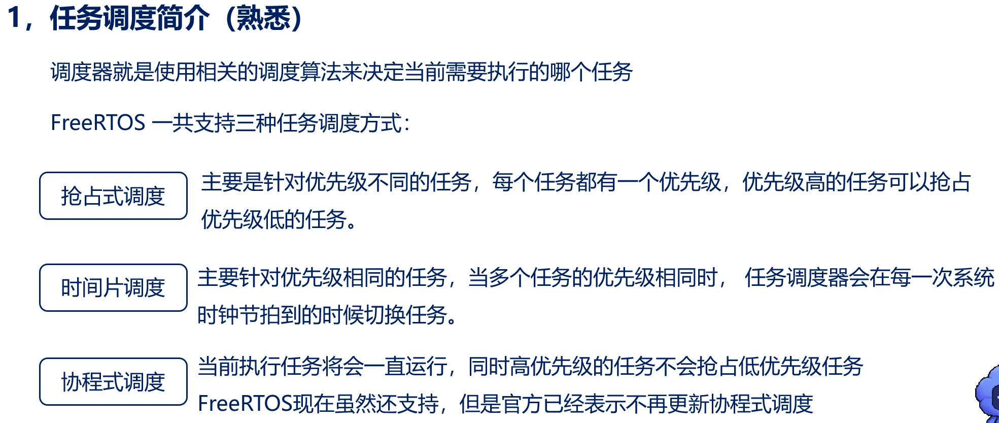
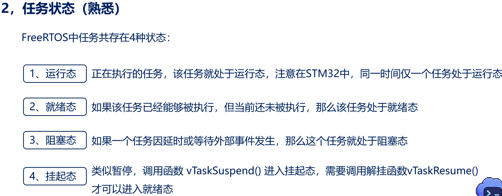
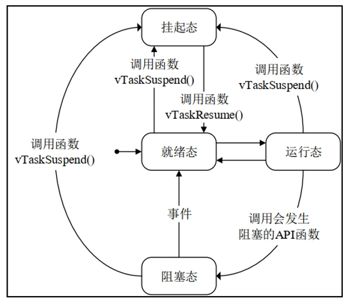
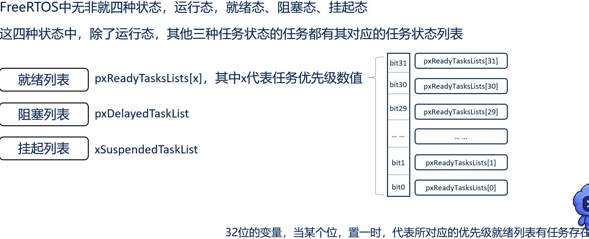
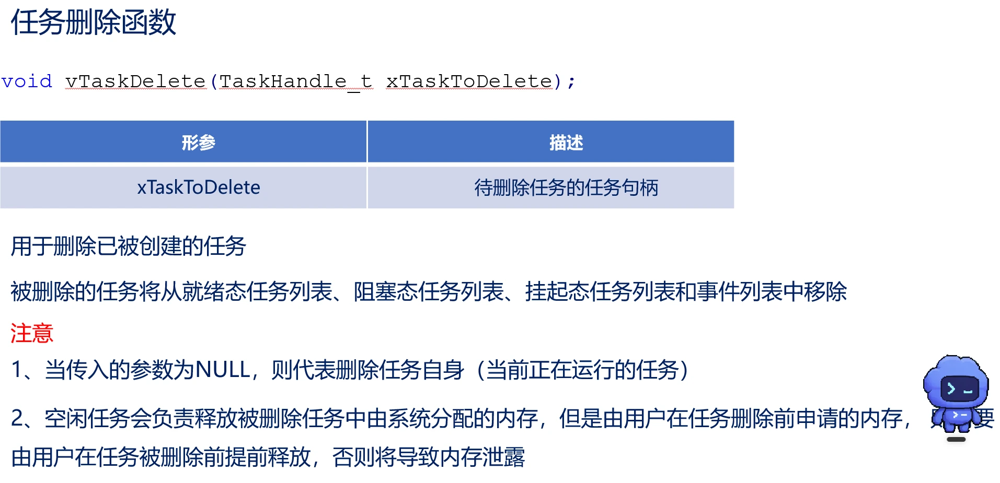

# 任务调度与任务状态

调度器总是在所有处于就绪列表的任务中，选择具有最高优先级的任务来执行
比如说有TaskA和TaskB，两个的优先级相同但毫无相关，在TaskA处于挂起或者阻塞态下，TaskB会优先运行。
换句话说调度器只关注处于Ready状态的任务，并选择其中优先级最高的任务运行。若最高优先级有多个任务，则按照时间片或调度策略选择其中一个。任务之间是否相关，由程序员通过阻塞、消息队列、信号量等机制管理。
# 任务创建与删除
【课件：04-FreeRTOS任务的创建与删除简介.ppt（文件未收录）】

空闲任务就是 FreeRTOS 的“兜底任务”：只要其他任务都不能运行，它就接管CPU；一旦有更高优先级任务变为 Ready，它会立即让出CPU。并且能保证CPU始终有任务运行、回收删除任务的资源、执行Idle Hook、进入低功耗。
# 任务挂起与任务恢复
【课件：05-FreeRTOS任务的挂起与恢复.ppt（文件未收录）】

