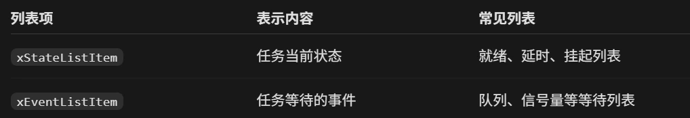
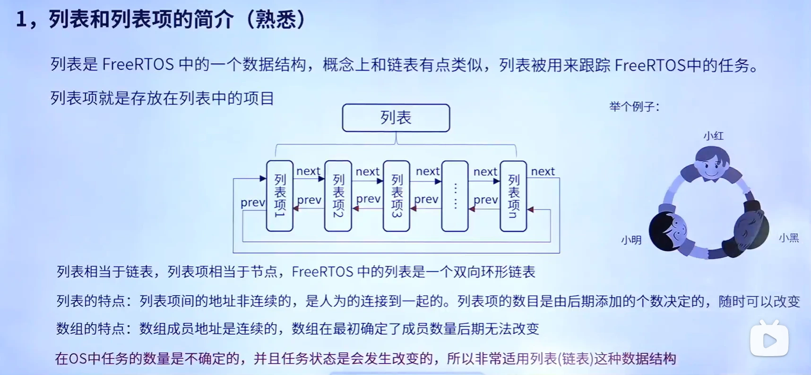
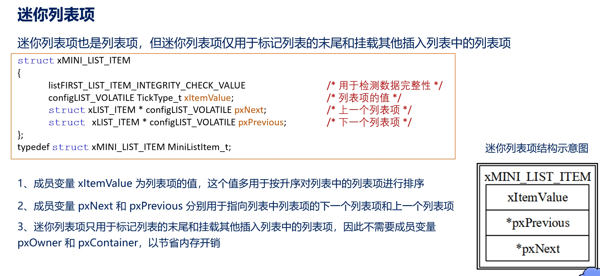
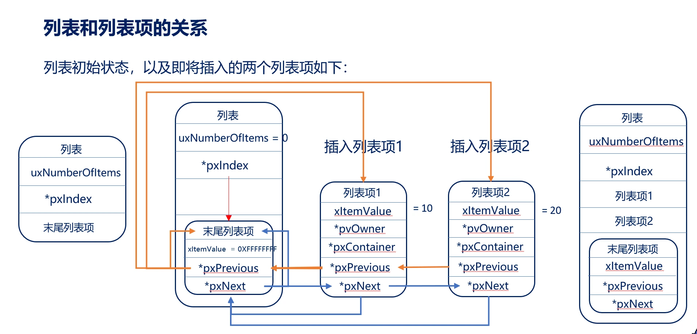
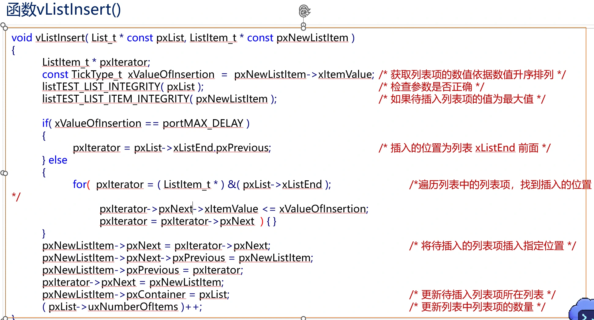

可以分为事件列表项和状态列表项

【课件：08-列表和列表项.ppt（文件未收录）】
列表强调“有顺序的一组元素”
链表强调“用指针把这些元素串起来”

**迷你列表项就是这个列表自己的“末尾标记项”**，它不代表任务，也不存放任务数据。
MiniListItem_t xListEnd
= 列表自带的尾部标记
= 哨兵节点
= 不属于某个任务
= 不会被插入到别的列表中

pxIndex 是遍历游标，指向上一次遍历到的列表项；初始化时指向 xListEnd。
uxNumberOfItems不包含末尾列表项
有多种插入方式，这取决于api函数
（
	vListInsertEnd()
	插到 pxIndex 前面附近，常用于同优先级任务的轮转调度
	vListInsert()
	按 xItemValue 从小到大插入，常用于延时列表，谁先到时间谁排前面
）

for循环来实现顺序排序

