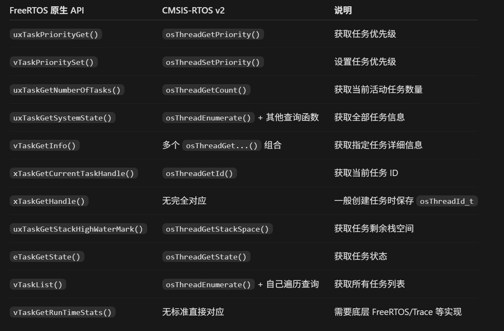
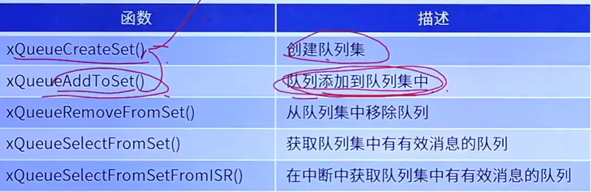
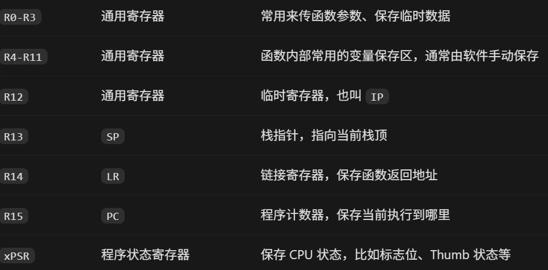
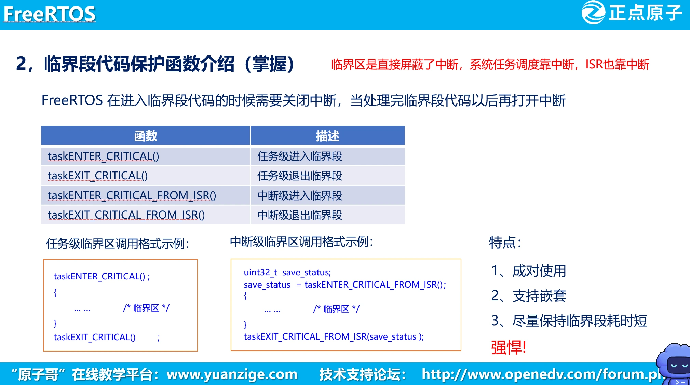
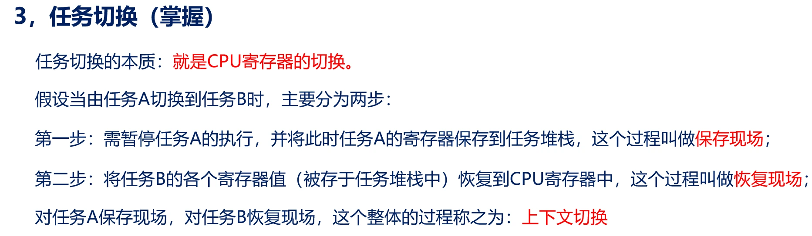
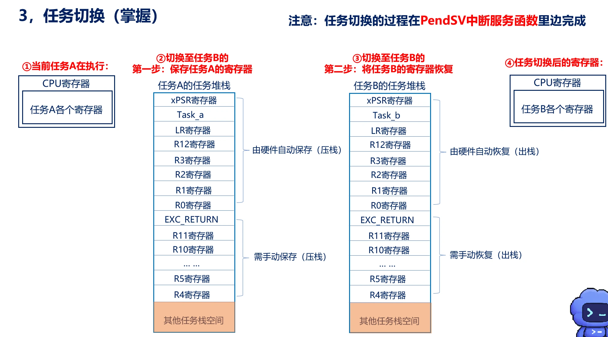

# 特有函数
## 任务
osThreadResume（任务恢复）
osThreadTerminate（删除任务）
osThreadExit(结束当前正在运行的任务，等同于terminate)
osThreadSuspend（挂起任务）
xTaskResumeFromISR（恢复中断任务）
taskENTER_CRITICAL（进入临界区，屏蔽freertos所管理的函数）
taskEXIT_CRITICAL（恢复临界区，打开freertos所管理的函数）
osKernelStart（开启任务调度器）


## 列表
vListInitialise（初始化列表）
listCURRENT_LIST_LENGTH（读取当前列表有多少个列表项）
vListInitialiseItem（初始化列表项）
listSET_LIST_ITEM_VALUE（设置id值）
vListInsertEnd（在列表尾部插入）
vListInsert（按id数值插入）
uxListRemove（删除列表项）
## 堆栈
pvPortMalloc()  ( FreeRTOS 动态申请内存接口）
vPortFree()      (FreeRTOS 释放内存接口）
xPortGetFreeHeapSize()（当前剩余堆空间）
xPortGetMinimumEverFreeHeapSize()（历史最低剩余堆空间）
uxTaskGetStackHighWaterMark(NULL)  （当前任务栈剩余空间）
## 队列
queue（队列头文件）
### 1. 创建队列

#### FreeRTOS

```
QueueHandle_t xQueueCreate(
    UBaseType_t uxQueueLength,
    UBaseType_t uxItemSize
);
```

参数：

- `uxQueueLength`：队列长度
- `uxItemSize`：每个队列元素大小

```
QueueHandle_t xQueueCreateStatic(
    UBaseType_t uxQueueLength,
    UBaseType_t uxItemSize,
    uint8_t *pucQueueStorageBuffer,
    StaticQueue_t *pxQueueBuffer
);
```

参数：

- `uxQueueLength`：队列长度
- `uxItemSize`：元素大小
- `pucQueueStorageBuffer`：队列存储区域
- `pxQueueBuffer`：队列控制块

#### CMSIS-RTOS V2

```
osMessageQueueId_t osMessageQueueNew(
    uint32_t msg_count,
    uint32_t msg_size,
    const osMessageQueueAttr_t *attr
);
```

参数：

- `msg_count`：消息数量
- `msg_size`：消息大小
- `attr`：消息队列属性

---

### 2. 删除队列

#### FreeRTOS

```
void vQueueDelete(
    QueueHandle_t xQueue
);
```

参数：

- `xQueue`：队列句柄

#### CMSIS-RTOS V2

```
osStatus_t osMessageQueueDelete(
    osMessageQueueId_t mq_id
);
```

参数：

- `mq_id`：消息队列ID

---

### 3. 发送数据

#### FreeRTOS

```
BaseType_t xQueueSend(
    QueueHandle_t xQueue,
    const void *pvItemToQueue,
    TickType_t xTicksToWait
);
```

参数：

- `xQueue`：队列句柄
- `pvItemToQueue`：发送数据地址
- `xTicksToWait`：等待时间

```
BaseType_t xQueueSendToBack(
    QueueHandle_t xQueue,
    const void *pvItemToQueue,
    TickType_t xTicksToWait
);
```

作用：

- 数据发送到队尾

```
BaseType_t xQueueSendToFront(
    QueueHandle_t xQueue,
    const void *pvItemToQueue,
    TickType_t xTicksToWait
);
```

作用：

- 数据发送到队头

```
BaseType_t xQueueOverwrite(
    QueueHandle_t xQueue,
    const void *pvItemToQueue
);
```

作用：

- 覆盖队列已有数据

#### CMSIS-RTOS V2

```
osStatus_t osMessageQueuePut(
    osMessageQueueId_t mq_id,
    const void *msg_ptr,
    uint8_t msg_prio,
    uint32_t timeout
);
```

参数：

- `mq_id`：消息队列ID
- `msg_ptr`：消息地址
- `msg_prio`：消息优先级
- `timeout`：等待时间

---

### 4. 接收数据

#### FreeRTOS

```
BaseType_t xQueueReceive(
    QueueHandle_t xQueue,
    void *pvBuffer,
    TickType_t xTicksToWait
);
```

参数：

- `xQueue`：队列句柄
- `pvBuffer`：接收数据存储地址
- `xTicksToWait`：等待时间

```
BaseType_t xQueuePeek(
    QueueHandle_t xQueue,
    void *pvBuffer,
    TickType_t xTicksToWait
);
```

作用：

- 查看队列数据但不删除

#### CMSIS-RTOS V2

```
osStatus_t osMessageQueueGet(
    osMessageQueueId_t mq_id,
    void *msg_ptr,
    uint8_t *msg_prio,
    uint32_t timeout
);
```

参数：

- `mq_id`：消息队列ID
- `msg_ptr`：接收消息地址
- `msg_prio`：消息优先级
- `timeout`：等待时间

---

### 5. 查询队列状态

#### FreeRTOS

```
UBaseType_t uxQueueMessagesWaiting(
    QueueHandle_t xQueue
);
```

作用：

- 获取当前队列消息数量

```
UBaseType_t uxQueueMessagesWaitingFromISR(
    QueueHandle_t xQueue
);
```

作用：

- ISR中获取消息数量

```
UBaseType_t uxQueueSpacesAvailable(
    QueueHandle_t xQueue
);
```

作用：

- 获取队列剩余空间

#### CMSIS-RTOS V2

```
uint32_t osMessageQueueGetCount(
    osMessageQueueId_t mq_id
);
```

作用：

- 获取当前消息数量

```
uint32_t osMessageQueueGetSpace(
    osMessageQueueId_t mq_id
);
```

作用：

- 获取剩余空间

---

### 6. 队列ISR函数

#### FreeRTOS

```
BaseType_t xQueueSendFromISR(
    QueueHandle_t xQueue,
    const void *pvItemToQueue,
    BaseType_t *pxHigherPriorityTaskWoken
);
```

参数：

- `xQueue`：队列句柄
- `pvItemToQueue`：发送数据地址
- `pxHigherPriorityTaskWoken`：是否需要任务切换

```
BaseType_t xQueueSendToFrontFromISR(
    QueueHandle_t xQueue,
    const void *pvItemToQueue,
    BaseType_t *pxHigherPriorityTaskWoken
);
```

```
BaseType_t xQueueReceiveFromISR(
    QueueHandle_t xQueue,
    void *pvBuffer,
    BaseType_t *pxHigherPriorityTaskWoken
);
```

#### CMSIS-RTOS V2

```
osStatus_t osMessageQueuePut(
    osMessageQueueId_t mq_id,
    const void *msg_ptr,
    uint8_t msg_prio,
    uint32_t timeout
);
```

```
osStatus_t osMessageQueueGet(
    osMessageQueueId_t mq_id,
    void *msg_ptr,
    uint8_t *msg_prio,
    uint32_t timeout
);
```

说明：

- CMSIS-RTOS V2 不区分 ISR 版本
## 队列集

## 信号量

semphr（信号量头文件）
### 1. 创建信号量

#### FreeRTOS

**二值信号量**

```
SemaphoreHandle_t xSemaphoreCreateBinary(
    void
);
```

参数：

- 无参数

作用：

- 创建二值信号量

---

**计数信号量**

```
SemaphoreHandle_t xSemaphoreCreateCounting(
    UBaseType_t uxMaxCount,
    UBaseType_t uxInitialCount
);
```

参数：

- `uxMaxCount`：信号量最大计数值
- `uxInitialCount`：信号量初始计数值

---

**静态二值信号量**

```
SemaphoreHandle_t xSemaphoreCreateBinaryStatic(
    StaticSemaphore_t *pxSemaphoreBuffer
);
```

参数：

- `pxSemaphoreBuffer`：静态信号量控制块

---

**静态计数信号量**

```
SemaphoreHandle_t xSemaphoreCreateCountingStatic(
    UBaseType_t uxMaxCount,
    UBaseType_t uxInitialCount,
    StaticSemaphore_t *pxSemaphoreBuffer
);
```

参数：

- `uxMaxCount`：最大计数值
- `uxInitialCount`：初始计数值
- `pxSemaphoreBuffer`：静态控制块

---

#### CMSIS-RTOS V2

```
osSemaphoreId_t osSemaphoreNew(
    uint32_t max_count,
    uint32_t initial_count,
    const osSemaphoreAttr_t *attr
);
```

参数：

- `max_count`：最大计数值
- `initial_count`：初始计数值
- `attr`：信号量属性

---

### 2. 获取信号量

#### FreeRTOS

```
BaseType_t xSemaphoreTake(
    SemaphoreHandle_t xSemaphore,
    TickType_t xTicksToWait
);
```

参数：

- `xSemaphore`：信号量句柄
- `xTicksToWait`：等待时间

---

#### CMSIS-RTOS V2

```
osStatus_t osSemaphoreAcquire(
    osSemaphoreId_t semaphore_id,
    uint32_t timeout
);
```

参数：

- `semaphore_id`：信号量ID
- `timeout`：等待时间

---

### 3. 释放信号量

#### FreeRTOS

```
BaseType_t xSemaphoreGive(
    SemaphoreHandle_t xSemaphore
);
```

参数：

- `xSemaphore`：信号量句柄

---

#### CMSIS-RTOS V2

```
osStatus_t osSemaphoreRelease(
    osSemaphoreId_t semaphore_id
);
```

参数：

- `semaphore_id`：信号量ID

---

### 4. ISR中获取信号量

#### FreeRTOS

```
BaseType_t xSemaphoreTakeFromISR(
    SemaphoreHandle_t xSemaphore,
    BaseType_t *pxHigherPriorityTaskWoken
);
```

参数：

- `xSemaphore`：信号量句柄
- `pxHigherPriorityTaskWoken`：是否需要任务切换

---

#### CMSIS-RTOS V2

无独立 ISR 获取函数。

使用：

```
osSemaphoreAcquire(
    osSemaphoreId_t semaphore_id,
    uint32_t timeout
);
```

说明：

- CMSIS-RTOS V2统一接口

---

### 5. ISR中释放信号量

#### FreeRTOS

```
BaseType_t xSemaphoreGiveFromISR(
    SemaphoreHandle_t xSemaphore,
    BaseType_t *pxHigherPriorityTaskWoken
);
```

参数：

- `xSemaphore`：信号量句柄
- `pxHigherPriorityTaskWoken`：是否需要任务切换

---

#### CMSIS-RTOS V2

```
osStatus_t osSemaphoreRelease(
    osSemaphoreId_t semaphore_id
);
```

参数：

- `semaphore_id`：信号量ID

说明：

- CMSIS-RTOS V2不区分普通释放和ISR释放

---

### 6. 查询信号量

#### FreeRTOS

```
UBaseType_t uxSemaphoreGetCount(
    SemaphoreHandle_t xSemaphore
);
```

参数：

- `xSemaphore`：信号量句柄

作用：

- 获取当前信号量计数值

---

#### CMSIS-RTOS V2

```
uint32_t osSemaphoreGetCount(
    osSemaphoreId_t semaphore_id
);
```

参数：

- `semaphore_id`：信号量ID

作用：

- 获取当前信号量计数值

---

### 7. 删除信号量

#### FreeRTOS

```
void vSemaphoreDelete(
    SemaphoreHandle_t xSemaphore
);
```

参数：

- `xSemaphore`：信号量句柄

---

#### CMSIS-RTOS V2

```
osStatus_t osSemaphoreDelete(
    osSemaphoreId_t semaphore_id
);
```

参数：

- `semaphore_id`：信号量ID


# API函数
API函数（Application Programming Interface，应用程序接口函数）就是别人已经写好的函数，通过调用这些函数，你可以使用某个模块的功能，而不需要知道它内部怎么实现。
# TCB
Task Control Block（任务控制块），每一个任务的“身份证 + 档案袋”
存放着任务名称，任务状态，任务优先级，任务栈指针（运行到哪存放到哪），任务链表节点，任务句柄，以及其他信息。
创建任务时先在堆里申请分配TCB空间比如TCB_A，再在堆里申请任务栈比如TaskA Stack，初始化TCB-A后根据其状态分配到相应列表
# 函数调用中的压栈与弹栈

## 1. 核心概念

CPU执行程序时，主要依靠：

|寄存器|作用|
|-|-|
|PC（Program Counter）|记录下一条要执行的指令地址|
|SP（Stack Pointer）|记录当前栈顶地址|

其中：

- PC负责控制程序执行位置
- SP负责管理运行过程中保存的数据


---

## 2. 为什么需要栈？

考虑函数调用：

```c
int main()
{
    fun();

    return 0;
}


void fun()
{
    int a = 10;
}
```

CPU执行：

```
main
 |
 ↓
fun
 |
 ↓
返回main继续执行
```

问题：

执行完fun后，CPU怎么知道回到main哪里？

所以需要保存：

```
返回地址
```

这个地址保存在：

```
栈(Stack)
```

---

## 3. 压栈（Push）

### 3.1 什么是压栈？

压栈：

> 将数据保存到栈中，同时移动SP指针。

STM32 Cortex-M：

栈向低地址方向增长。

即：

```
地址增加

888

884

880

地址减少
```

---

### 3.2 调用函数过程


初始：

```
888 ← SP
```

---

调用fun：

需要保存返回地址：

```
888

884 ← SP

返回地址
```

此时：

```
SP = 884
```

---

进入fun：

局部变量：

```c
int a = 10;
```

保存a：

```
888

返回地址

884

a=10

880 ← SP
```

此时：

```
SP = 880
```

---

## 4. 弹栈（Pop）

### 4.1 什么是弹栈？

弹栈：

> 从栈中取出数据，并释放对应空间，使SP恢复。

注意：

弹栈不是删除数据。

而是：

> SP移动后，这块空间重新可以使用。

---

## 5. 函数结束时的弹栈过程


fun执行结束：

当前：

```
888

返回地址

884

a=10

880 ← SP
```


---

### 第一步：释放局部变量a

弹出a：

```
880

↑

884 ← SP
```

结果：

```
SP = 884
```

---

### 第二步：恢复返回地址

弹出返回地址：

```
884

↑

888 ← SP
```

结果：

```
SP = 888
```

同时：

```
PC = 保存的返回地址
```

CPU回到main继续执行。

---

## 6. 完整流程


```
main运行

PC指向main代码


调用fun()

↓

保存返回地址（压栈）

↓

PC跳转到fun


↓

保存局部变量a（压栈）


↓

fun执行


↓

释放a（弹栈）

↓

恢复返回地址（弹栈）


↓

PC恢复

↓

回到main
```

---

## 7. PC和SP的关系


### PC

负责：

```
下一条指令在哪里
```

例如：

```
1000
 ↓
1004
 ↓
1008
```


通常：

```
PC地址增加
```


---

### SP

负责：

```
当前栈顶在哪里
```

例如：

```
888
 ↓
884
 ↓
880
 ↑
884
 ↑
888
```


STM32：

```
压栈：
SP下降


弹栈：
SP上升
```

---

## 8. 与FreeRTOS任务切换的联系


函数调用：

```
保存返回地址
 ↓
跳转函数
 ↓
恢复返回地址
```

---

RTOS任务切换：

```
保存任务A现场

↓

保存SP到TCB

↓

切换任务B

↓

恢复任务B SP

↓

恢复任务B现场

↓

继续执行
```

---

任务栈中保存：

```
R0-R12
LR
PC
PSR
```

其中：

PC决定：

```
任务从哪里继续运行
```

SP决定：

```
任务现场保存在哪里
```

---

## 9. 重要总结

> PC负责“程序执行到哪里”。

> SP负责“当前运行状态保存在哪里”。

> 压栈会导致SP下降，弹栈会导致SP上升。

> 函数调用通过栈保存返回地址，使程序能够正确返回。

> FreeRTOS任务切换，本质也是保存和恢复任务栈中的CPU现场。
# 临界区


# 上下文切换以及pendsv中断
【课件：09-任务调度.ppt（文件未收录）】


新任务创建时先“预置栈帧”，任务运行前再“出栈恢复现场”。
因为这个“压栈”不是任务运行过程中 CPU 自己真的执行 `PUSH` 形成的，而是 FreeRTOS 在创建任务时直接把对应的数据写进栈里。
第一次运行：
预置栈帧 → 出栈 → 开始运行

以后运行：
压栈保存 → 被切走 → 出栈恢复 → 继续运行
# 