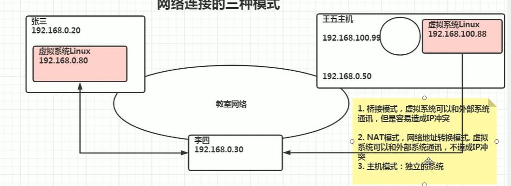

网段就相当于小区，是ip地址的前几位，例如ip地址192.168.0.20，192.169.0就是网段，后面的20是该用户的个人ip地址，ip地址一共有32位，分为4个8，ip地址分为/24和/16模式，例如/24是前24位是网段，后8位是主机
1.桥接模式
桥接模式是从网段上的基础上单开一个ip地址，所以当用户增多时ip地址会不够用
2.NAT模式
类似于VPN，NAT模式会让主机多一个虚拟网卡，等同于有了两个网络视角，一是子机与主机共用一个虚拟网卡，二是子机可以通过主机的网段来询问外网，而外网一般不能操控子机
3.主机模式
一个独立的系统

