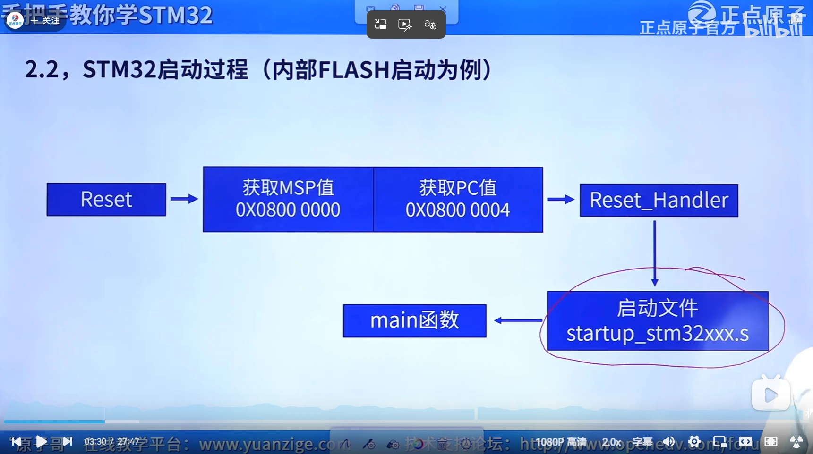
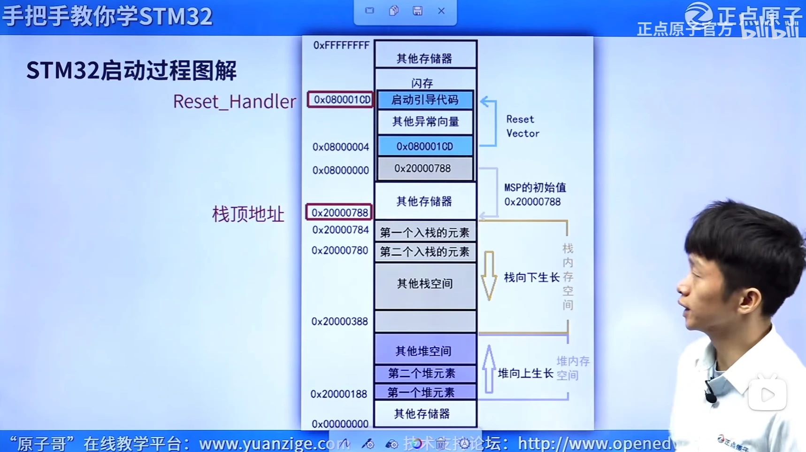
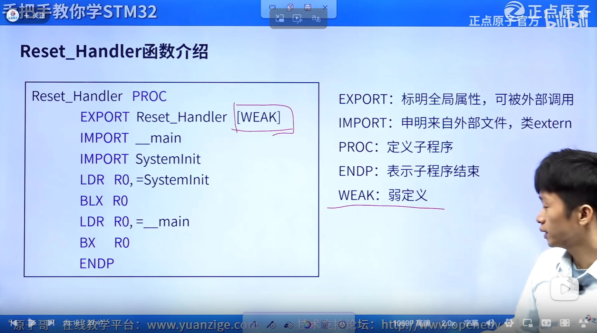
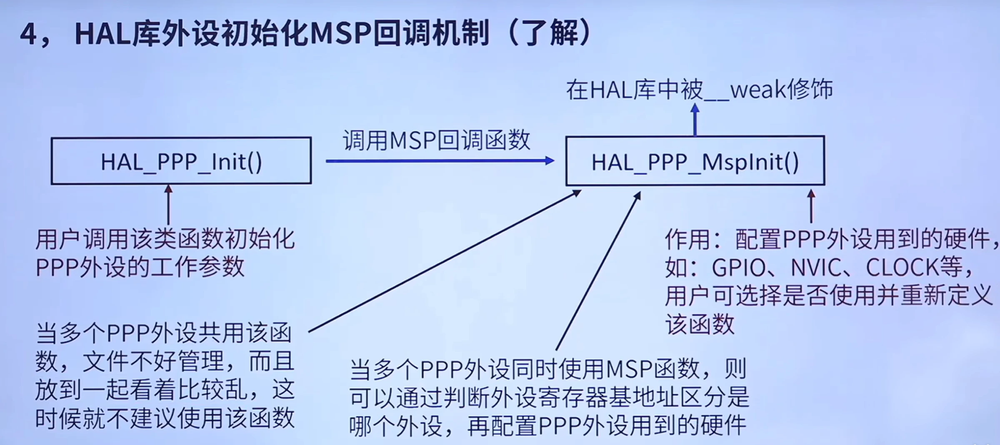
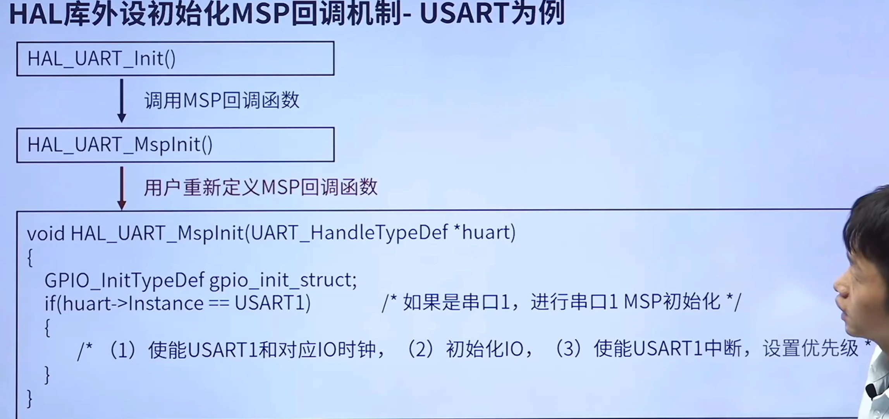
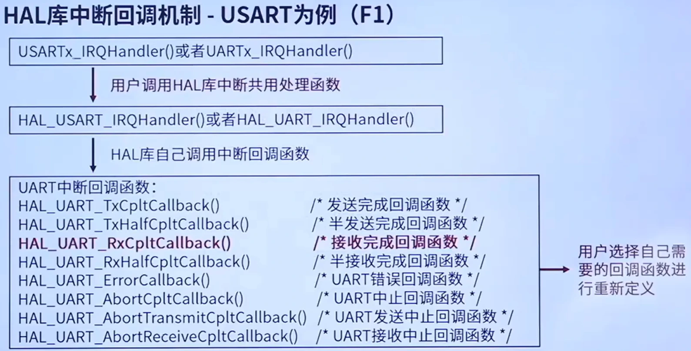

# 启动模式

这张图是stm32通过flash启动的例子
- 1.复位后，内核将0x00000000作为向量基地址，一定会去访问0x00000000拿初始msp，0x00000004拿复位入口但关键：0x00000000 不是真实物理存储器，是可重映射的 “映射地址”，它指向哪一块存储，由芯片 BOOT 引脚启动模式决定。
因为是通过flash启动，所以映射到0x0800 0000去找msp的地址
- 2.栈向下生长，堆向上生长，堆首地址通过栈顶地址减去栈与堆的大小确定
- 3.msp又叫栈顶地址，pc值又叫复位向量
msp通过栈顶地址可以找到第一个入栈的元素，然后整个栈的大小通过用户自己规定。
复位时 PC 直接加载复位向量（Reset_Handler 地址），跳转进入启动文件startup.s里的复位引导代码

[栈堆](../../notes.html?note=note-28)
# HAL库回调机制

