【课件：CAN总线入门教程.pptx（文件未收录）】

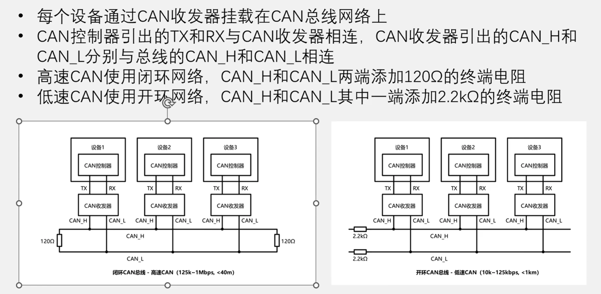
1.高速 CAN 的120Ω终端电阻，就是为了匹配CAN双绞线约120Ω的特性阻抗，吸收信号能量，防止高速信号在线末端反射造成振铃和通信错误。
2.把CAN线当普通通信线路处理，通过较大的偏置电阻保证电平和故障容错，速度低所以反射影响不明显。
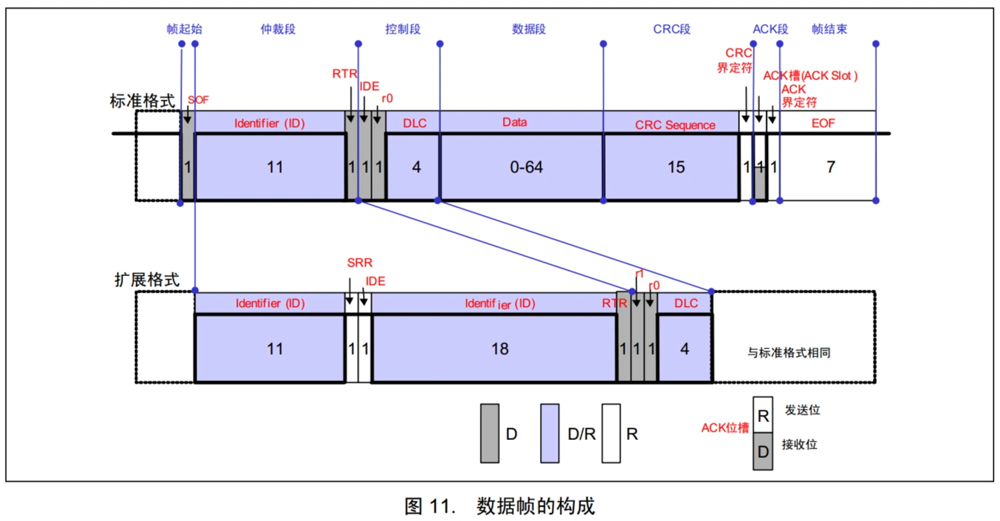
SRR:保证在仲裁下，标准格式优先于拓展格式
IDE:判别数据帧的格式
RTR：判别是数据帧还是遥控帧，在ID位的后面
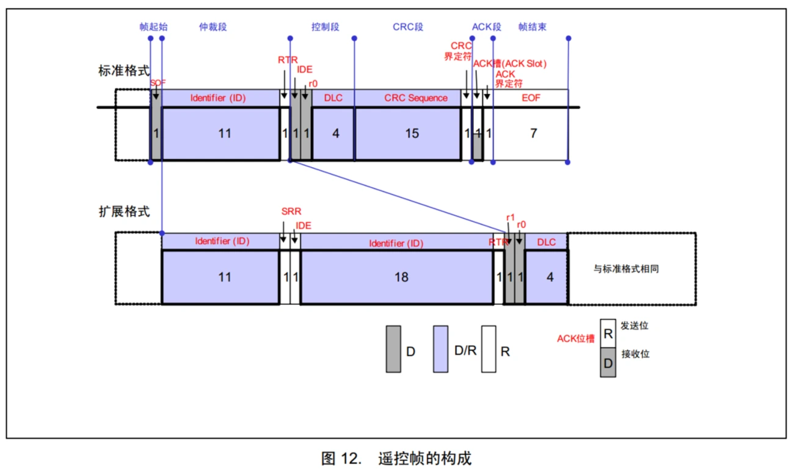
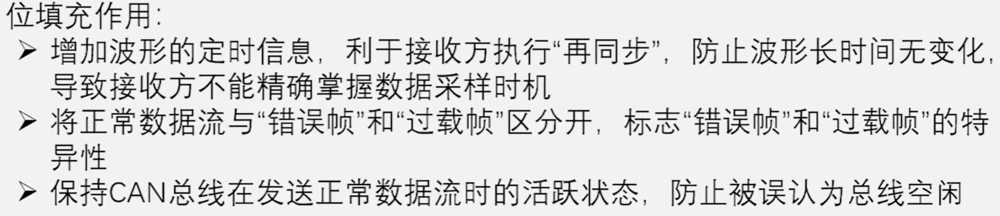
不填充：
❌ CRC界定符  
❌ ACK界定符  
❌ EOF  
❌ 错误帧  
❌ 过载帧
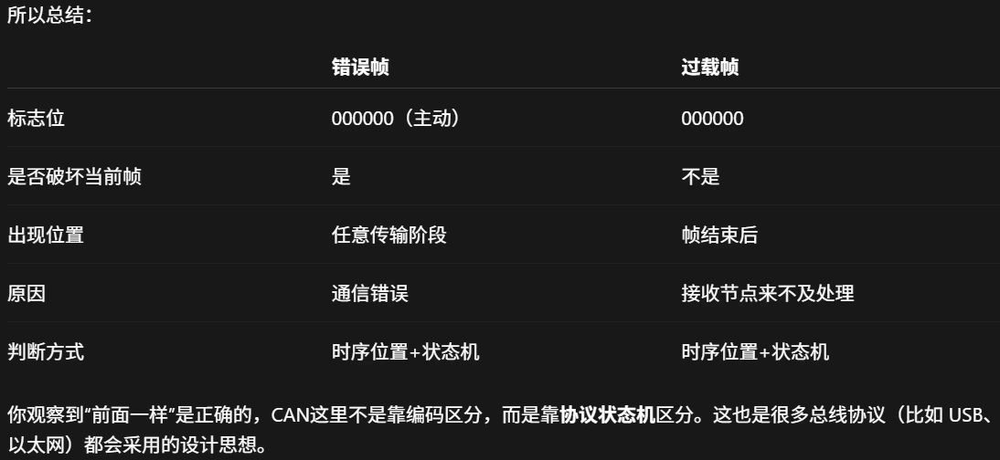
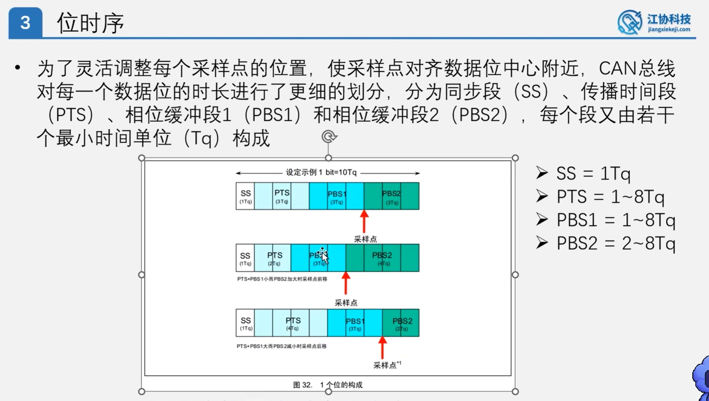
SS为同步段，波形的落位必须出在SS，不在就进行硬同步或者再同步
PTS类似按键消抖
PBS1和PBS2之间为采样点
后三个可任意配置时间
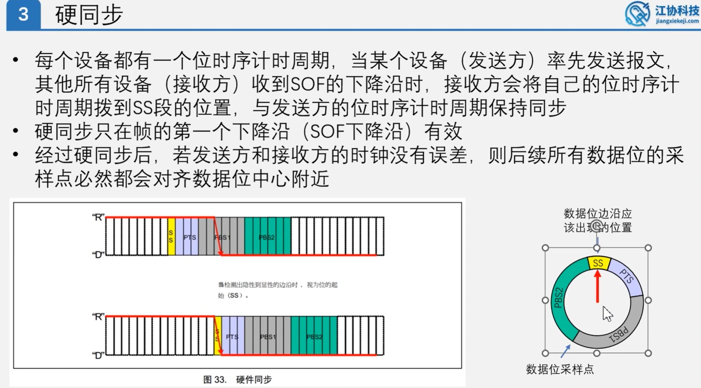
硬同步只会用一次
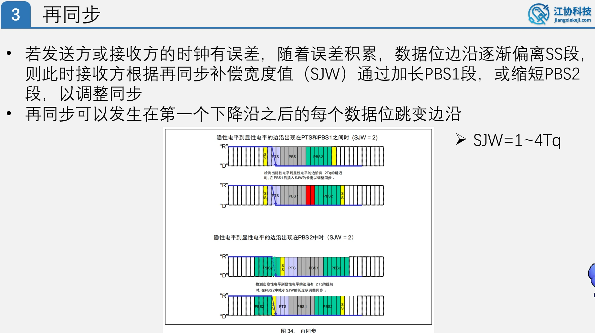
接收方调整的对象是自己的采样时钟，而调整依据是检测到的总线边沿。SJW越大，接收方一次修改自己时钟的幅度越大，所以如果同步依据错误，自己的时间位置会偏得更多。比如说一个噪音导致毛刺产生，SJW太大会导致系统误认为本次毛刺也为一个数据，从而导致接收方数据错误
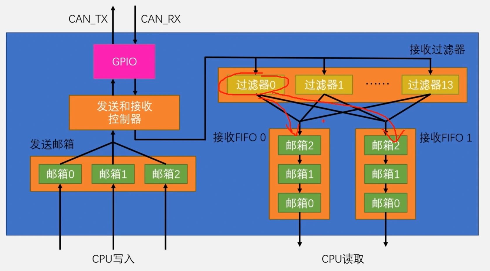
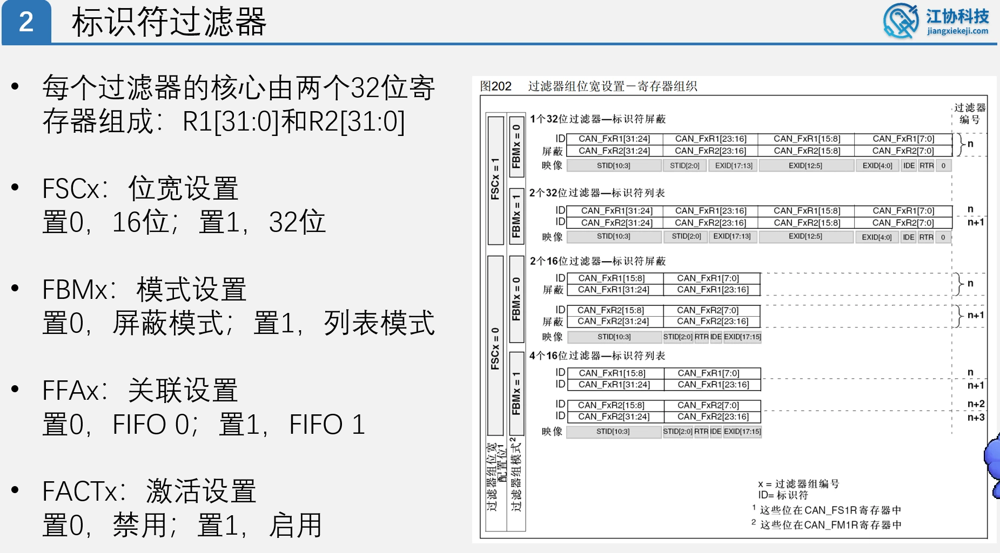
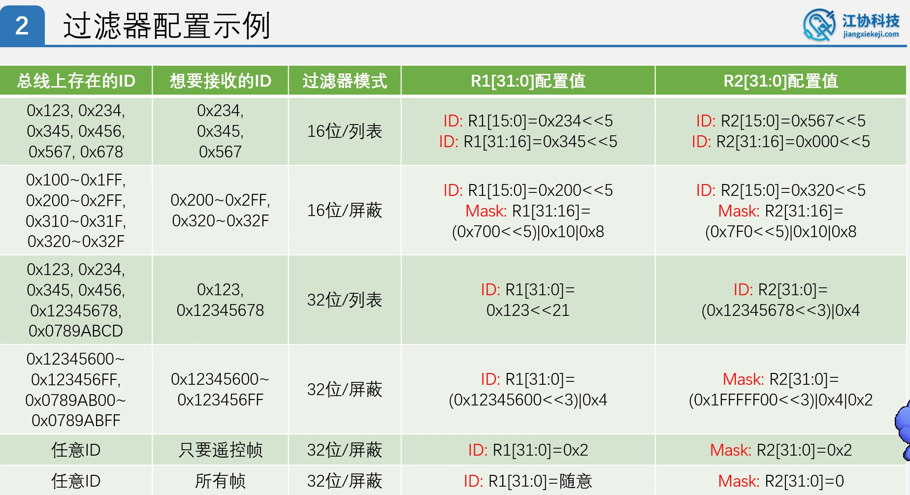
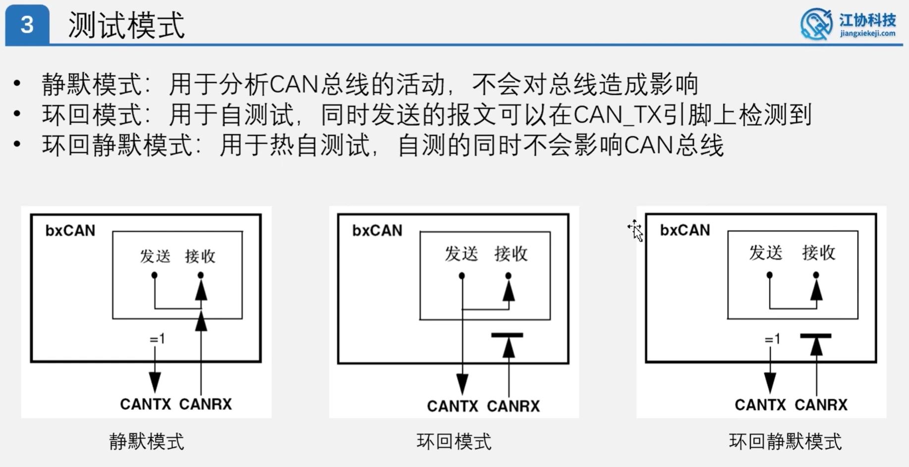