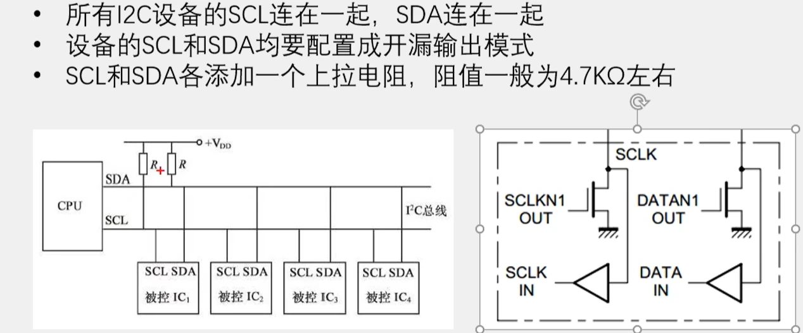
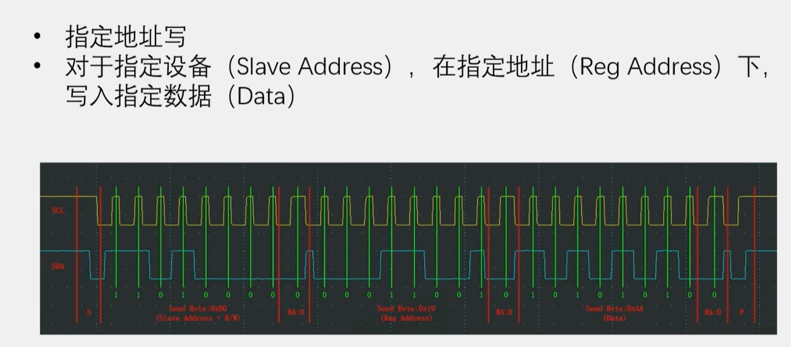
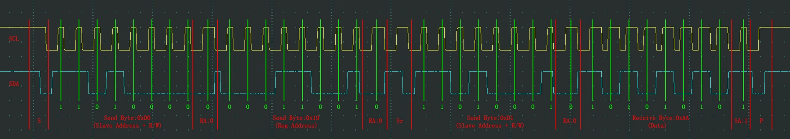
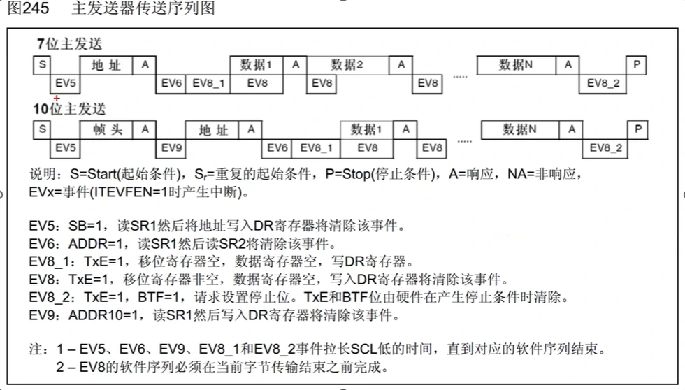
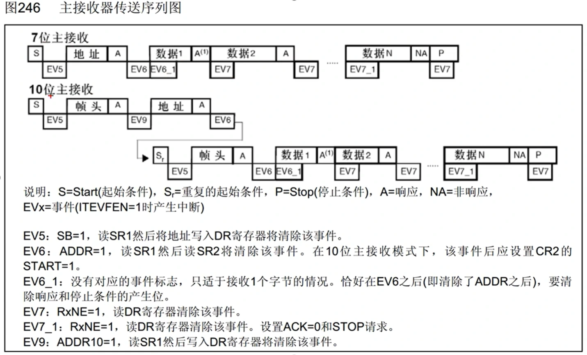
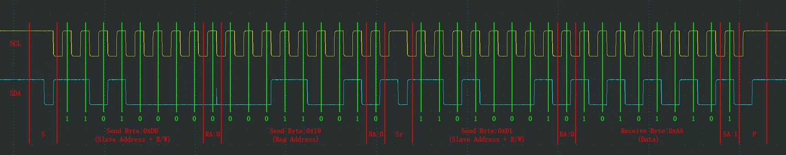

【课件：IIC实验.pptx（文件未收录）】

上拉电阻：
1.为开漏输出提供默认高电平，避免总线悬空造成的不确定状态；
2.当多个设备连接同一总线时，任何设备均可通过开漏结构主动拉低总线，实现线与逻辑；
3.配合输入缓冲器，使设备既可以输出数据，也可以读取总线状态。

I2C分为7位地址与十位地址，然后后面再加上R/W读写位
软件波形

复合格式可以实现指定设备指定地址的具体操作，然后start与R/W位是绑定的

1.10位主发送的帧头开头是11110
2.数据1时DR为空，是因为地址发送完成后，硬件只完成了“找设备”的过程，并不知道第一个数据是什么，所以必须等待CPU第一次写DR；而后续数据利用双缓冲机制，可以提前写入DR，因此EV8不会长时间存在。

硬件波形
